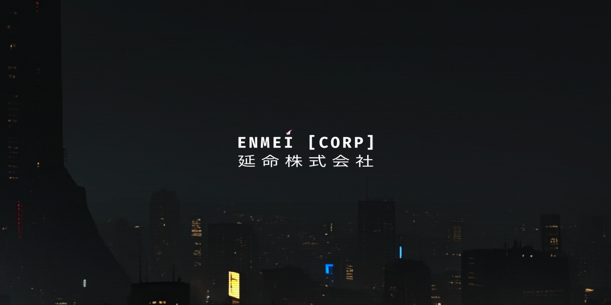

<!-- PLACEHOLDER: MAIN BANNER (assets/banner_enmei.png) -->

  

  
  
  
  

---

## // MANIFESTO

Modern computing is trapped in continuous decay.

Software today has become disposable—subjugated to volatile remote dependencies, telemetry, planned obsolescence, and bloated abstraction layers. What should be durable instruments are instead shipped as leased services designed to degrade the moment a centralized endpoint disappears.

**ENMEI (延命)** stands for *prolonging life* and *sustaining existence*.

We reject ephemeral software. We design and forge **Digital Artifacts**: deterministic, self-contained, and structurally sealed tools engineered to execute with identical precision today, in ten years, or across decades—without reliance on subscription models, cloud backends, or constant maintenance.

We do not build subscriptions. We forge immutable artifacts.

---

## // CORE PRINCIPLES

| Pillar | Architecture | Objective |
| :--- | :--- | :--- |
| **Doneware Invariance** | Sealed binaries • Zero dynamic dependencies • Immutable file targets | Software is finished upon reaching mathematical completion. Zero planned obsolescence. |
| **Radical Sovereignty** | Air-gapped execution • Zero telemetry • Cryptographic integrity checks | Tools exist strictly on the user's terms. No background calls, no behavioral profiling. |
| **Mechanical Sympathy** | Bare-metal Rust & modern C++ • Deterministic memory layouts • Zero-GC | Low-overhead execution targeting direct hardware registers, cache locality, and raw pixel buffers. |

---

## // RESEARCH & ENGINEERING DOMAINS

* **Resilient Systems:** Low-overhead architectures in modern Rust and ISO C++ (C++23/26) targeting long-term stability and platform longevity.
* **Hermetic Runtimes:** Standalone data structures and offline storage models designed to resist bit-rot, operating system decay, reversing and zero day exlpoits.
* **Sensory Ergonomics:** Non-destructive interfaces engineered for cognitive focus, low visual fatigue, and biological comfort.
* **Deterministic Signal Filtration:** Algorithmic curation pipelines that separate durable human knowledge from automated information noise.

---

## // DEPLOYMENT PROTOCOL

Artifacts developed under **ENMEI [CORP]** are published only upon reaching full mechanical completion. We do not publish speculative roadmaps or maintain active tracking threads for works in progress.

When a capsule is sealed, the distribution will appear here.

---

  <!-- PLACEHOLDER: ENMEI LOGO FOOTER (assets/enmeilogo.png) -->
   
  Resisting entropy.

